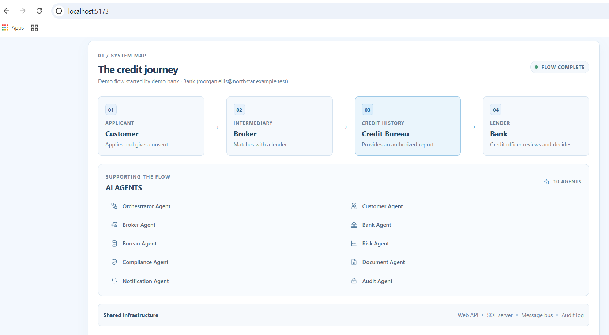
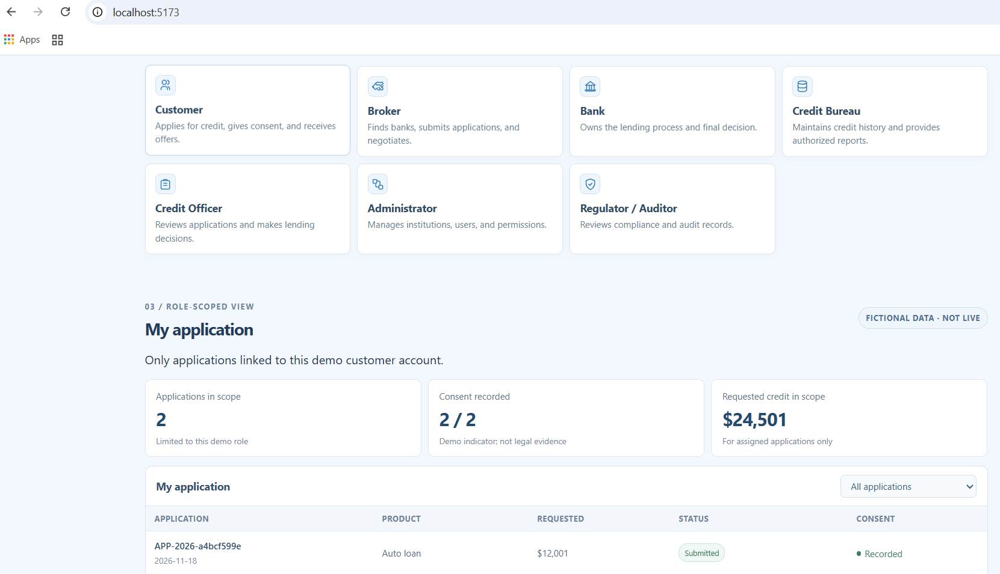
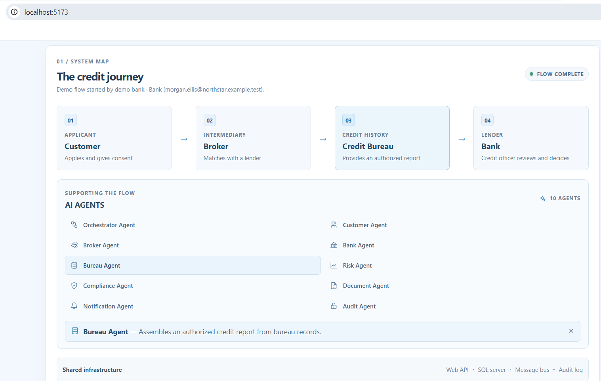
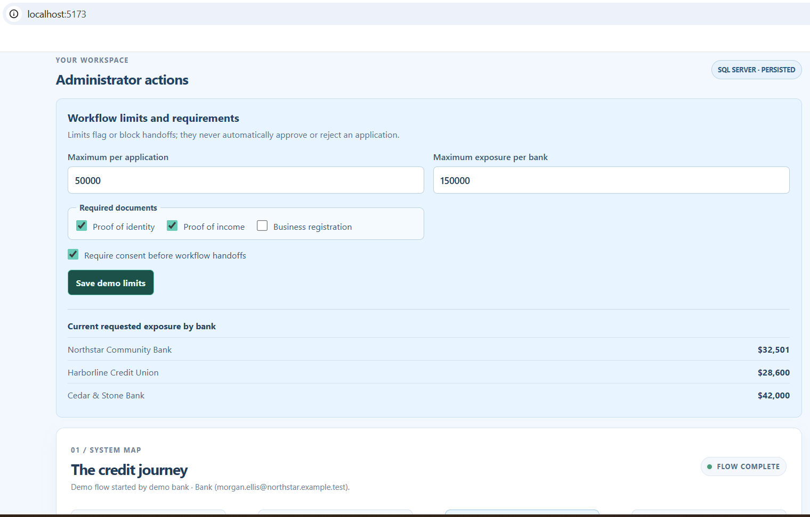
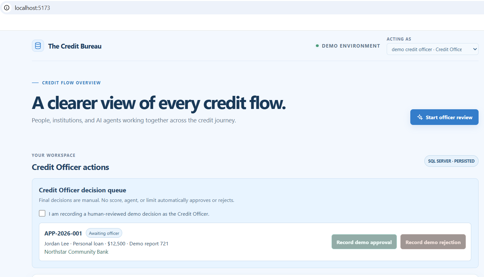

# The Credit Bureau

A credit-flow prototype for customers, brokers, banks, a credit bureau, and their software agents. The workspace separates the React TypeScript frontend, ASP.NET Core API, SQL Server schema/seeds, agent definitions, and project documentation.

## Run the frontend

```powershell
cd frontend\credit-bureau-web
npm install
npm run dev
```

Run `npm run typecheck` and `npm run build` from that folder to validate the frontend.

## Run the demo API

With the .NET 10 SDK installed:

```powershell
dotnet run --project backend\CreditBureau.Api --urls http://localhost:5250
```

The API uses SQL Server LocalDB via `ConnectionStrings:CreditBureau` and exposes the demo-state, application workflow, and limits endpoints. The default connection is in `backend\CreditBureau.Api\appsettings.json`; override it with the `ConnectionStrings__CreditBureau` environment variable when needed. The OpenAPI document is available at `/openapi/v1.json` in Development.

## Demo data and SQL

The frontend loads customers, banks, brokers, demo accounts, applications, reports, workflow limits, and audit events through the API. Application submissions, workflow status changes, officer decisions, reports, limit changes, and audit events are written to SQL Server and remain after a page reload. All records use invented identifiers and `.test` email addresses. An application without consent has no demo report. Seed scripts are not run automatically:

1. Apply `database\schema.sql` to an isolated SQL Server demo database.
2. Apply `database\procedures.sql` to create the transactional workflow procedures.
3. Apply `database\seed.sql` to add fictional sample records.

The `(localdb)\MSSQLLocalDB` instance has been seeded into `TheCreditBureauDemo`. To repeat the setup from the repository root with Windows authentication:

```powershell
sqlcmd -S "(localdb)\MSSQLLocalDB" -E -Q "IF DB_ID(N'TheCreditBureauDemo') IS NULL CREATE DATABASE [TheCreditBureauDemo];"
sqlcmd -S "(localdb)\MSSQLLocalDB" -E -d TheCreditBureauDemo -i database\schema.sql
sqlcmd -S "(localdb)\MSSQLLocalDB" -E -d  c -i database\procedures.sql
sqlcmd -S "(localdb)\MSSQLLocalDB" -E -d TheCreditBureauDemo -i database\seed.sql
```

The schema, procedure, and seed scripts are safe to rerun. Runtime application, report, workflow-setting, and audit writes use the database procedures. Seed updates only migrate the original sample statuses/documents and do not reset later workflow decisions or added applications.

Password-free demo identities are stored in the database for customer, broker, bank, credit bureau, credit officer, administrator, and regulator/auditor roles. Choose an identity in the header to change who is acting. The application portfolio and actor workspace filter records by the selected role; administrator and auditor views show aggregate or audit information only. These are demo client-side presentation rules, not authentication or production access control. See `docs\data-visibility.md` for the visibility matrix and limitations.

The actor workspace provides a database-backed application flow. Administrators can drag to reorder, add, or remove supported actor steps, including repeat steps for an actor, up to eight steps total; every configured step must be approved to continue, and any rejection stops the application. The final human Credit Officer step is mandatory. A Credit Bureau approval prepares a fictional report only when the customer has consented. Workflow changes apply to new applications; open applications retain the workflow snapshot they started with. Administrators can also adjust per-application and per-bank caps, consent requirements, and required documents; auditors see a privacy-minimized event list. Limits and missing requirements block approvals but never make a lending decision automatically.

## Agents and instructions

VS Code custom agents are in `.github\agents\`; Copilot coding guidance is in `.github\instructions\`. Agent role descriptions and workflow notes are under `agents\`.

## Prototype limitations

This project does not connect to a real credit bureau or send notifications. The API accepts a demo-account ID from the client and is not authenticated; client-side role filtering is not security. Do not expose it to untrusted networks or use it for real applicant data. The sample credit indicators are fictional and must not be used to assess real applicants. Lending decisions belong to an authorized human credit officer.





